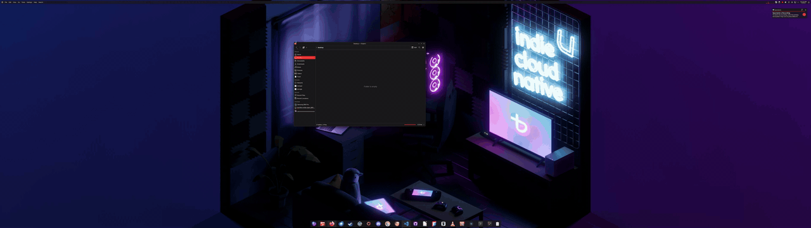

# FancyKZones


KDE KWin Script for snapping windows into zones. Handy when using a (super) ultrawide monitor, an alternative to PowerToys FancyZones and Windows 11 snap layouts.

FancyKZones is a fork of [KZones](https://github.com/gerritdevriese/kzones) by gerritdevriese, reworked to look, feel and operate more like [PowerToys FancyZones](https://learn.microsoft.com/windows/powertoys/fancyzones). Zones come from the tiling layouts built into KDE Plasma, windows can span multiple zones, and everything can be done with the mouse alone, as far as the limits of KWin scripts allow.

## What's different from KZones

### Designed to work like FancyZones

Drag a window, see the zones, drop it. While spanning, every zone between the zone you started from and the zone under the cursor is highlighted, so you can see exactly where the window will land, just like FancyZones.

### Mouse-only controls

While dragging, FancyZones uses <kbd>Shift</kbd> or a non-primary mouse button to show the zones and <kbd>Ctrl</kbd> to select multiple zones. KWin scripts can't see mouse buttons or modifier keys during a drag, so FancyKZones uses gestures that only need the cursor instead:

- **Hold still on a zone indicator** to start spanning, a ring around the cursor shows the progress. Move off it and hold still on an indicator again to stop spanning, the ring drains instead.
- **Bump a window into the edge of the screen** to show or hide the zone overlay.
- **Drop a window close to the border between zones** to span both of them.

The keyboard [shortcuts](#shortcuts) still work too, including shortcuts to toggle the overlay and spanning while dragging.

### Zones from KWin tiling

There are no JSON layouts to maintain. Zones are the tiles of the KWin tiling layout of each screen and virtual desktop, edited with <kbd>Meta</kbd> + <kbd>T</kbd>. A window snapped into a single zone is tiled by KWin itself, so it works together with the built-in tiling features, and spanned windows follow their tiles when the layout is edited.

### Removed

Because layouts now come from KWin, the JSON layouts, layout cycling, the activate layout shortcuts, tracking the layout per screen and the per-zone `applications`, `color` and `indicator` options are gone.

## Features

### Zone Selector

The Zone Selector is a small widget that appears when you drag a window to the top of the screen. It shows the zones of the current screen and lets you snap the window to one of them.


### Zone Overlay

The Zone Overlay is a fullscreen overlay that appears when you move a window. It shows all zones from the current layout and the window will snap to the zone you drop it on.


### Edge Snapping

Edge Snapping allows you to snap windows to zones by dragging them to the edge of the screen.


### Zone Spanning

Drop a window across multiple zones at once. Hold the cursor still on a zone indicator to start spanning from that zone, then drag over the other zones you want. Like FancyZones, the span is always the smallest rectangle of zones covering the zone you started from and the zone under the cursor, so moving back shrinks it again.

The overlay makes it clear which mode you are in:

- the zone indicators and the zone selector show the span as a single merged block, with a dot on the zone the span started from
- a chain link badge pops up on every indicator and the indicator borders light up



### Edge Bumping

Bump a window into the edge of the screen to show the zone overlay, bump it again to hide it. Useful when the overlay is set to only show when asked for.

### KWin Tiling Layouts

Zones come straight from the tiling layouts built into KDE Plasma. Edit them with <kbd>Meta</kbd> + <kbd>T</kbd>, every screen and virtual desktop has its own layout.

### Keyboard Shortcuts

FancyKZones comes with a set of [shortcuts](#shortcuts) to move your windows between zones.


### Theming

By using the same colors as your selected color scheme, FancyKZones will blend in perfectly with your desktop.


## Installation

Clone the repo and build it yourself, make sure you have "zip" installed on your system before building.

```sh
git clone https://github.com/mdhiggins/FancyKZones
cd FancyKZones && make
```

FancyKZones is installed as a separate script, if you also have KZones installed disable it first so they don't both snap windows.

## Configuration

The script settings can be found under `System Settings / Window Management / KWin Scripts / FancyKZones / ⚙️`

### General

#### Zone Selector

The zone selector is a small widget that appears when you drag a window to the top of the screen. It shows the zones of the current screen and lets you snap the window to one of them.

- Enable or disable the zone selector.
- Set the distance from the top of the screen at which the zone selector will start to appear.

#### Zone Overlay

The zone overlay is a fullscreen overlay that appears when you move a window. It shows all zones from the current layout and the window will snap to the zone you drop it on.

- Enable or disable the zone overlay.
- Choose whether the overlay should be shown when you start moving a window or when you press the toggle overlay shortcut.
- Choose where the cursor needs to be in order to highlight a zone, either in the center of the zone or anywhere inside the zone.
- Choose if you want the indicator to display all zones or only the highlighted zone.

#### Edge Snapping

Edge Snapping allows you to snap windows to zones by dragging them to the edge of the screen. Make sure to disable the default edge snapping functionality before enabling this.

Edge Bumping shows the zone overlay when you bump a window into the edge of the screen, bump again to hide it.

- Choose between edge snapping, edge bumping or disabled.
- Set the distance from the edge of the screen at which edge snapping or bumping triggers.

#### Remember and restore window geometries

The script will remember the geometry of each window when it's moved to a zone. When the window is moved out of the zone, it will be restored to it's original geometry.

- Enable or disable this behavior.

#### Automatically snap all new windows

When a new window is launched, the script will automatically snap it to its closest zone.

- Enable or disable this behavior.

> [!NOTE]  
> If you enable this, you should probably add some filters to exclude certain applications from being snapped, like games or other applications that don't work well with tiling.
> Spectacle is a good example of this, as it won't be able to take screenshots of the entire screen when it's snapped to a zone.

#### Display OSD messages

Disable this if you don't want to see any OSD messages.

- Enable or disable this behavior.

#### Zone spanning

A window can be dropped across multiple zones at once. While spanning, the window covers the smallest rectangle of zones between the zone spanning started from and the zone under the cursor, moving back shrinks the span again.

- Hold the cursor still on the indicator in the middle of a zone (or on a zone in the zone selector) while moving a window, a ring around the cursor fills up and spanning starts from that zone. Move off the indicator and hold still on any zone indicator again to stop spanning, the ring drains instead. The delay can be changed, or this can be disabled.
- While spanning, the indicators show the span as one merged block and a chain link badge.
- Press the toggle zone spanning shortcut while moving a window.
- Set an adjacent zone spanning distance, dropping a window this close to the border between zones spans them.

#### Fade windows while moving

Reduce the opacity of other windows while the active window is being moved.

- Enable or disable this behavior.

### Layouts

FancyKZones uses the KWin tiling layout of the screen and virtual desktop the window is on, there is nothing to configure in the script itself.

- Press <kbd>Meta</kbd> + <kbd>T</kbd> to open the tile editor on the current screen, and split, resize or remove tiles.
- Every tile in the layout is a zone. Zones are numbered in the order of the layout, from left to right and top to bottom.
- The padding between windows is the padding set in the tile editor.
- Changes are picked up immediately. Windows snapped into a zone follow their tile when it is resized, including windows spanning multiple zones.

A window snapped into a single zone is tiled by KWin itself, so it also works together with the built-in tiling features, like dragging a window into a tile while holding <kbd>Shift</kbd>. Resizing a snapped window works like FancyZones: only that window changes size, the layout itself only changes in the tile editor.

### Filters

Stop certain windows from snapping to zones by adding them to the filter list.

- Select the filter mode, either **Include** or **Exclude**.
- Add window classes to the list seperated by a newline.

You can enable the debug overlay to see the window class of the active window.

### Advanced

#### Polling rate

The polling rate is the amount of time between each zone check when dragging a window. The default is 100ms, a faster polling rate is more accurate but will use more CPU. You can change this to your liking.

#### Debugging

Here you can enable logging or turn on the debug overlay.

## Shortcuts

List of all available shortcuts:

| Shortcut                                           | Default Binding                                                     |
| -------------------------------------------------- | ------------------------------------------------------------------- |
| Move active window to zone                         | <kbd>Ctrl</kbd> + <kbd>Alt</kbd> + <kbd>Num 0-9</kbd>               |
| Move active window to previous zone                | <kbd>Ctrl</kbd> + <kbd>Alt</kbd> + <kbd>Left</kbd>                  |
| Move active window to next zone                    | <kbd>Ctrl</kbd> + <kbd>Alt</kbd> + <kbd>Right</kbd>                 |
| Switch to previous window in current zone          | <kbd>Ctrl</kbd> + <kbd>Alt</kbd> + <kbd>Down</kbd>                  |
| Switch to next window in current zone              | <kbd>Ctrl</kbd> + <kbd>Alt</kbd> + <kbd>Up</kbd>                    |
| Toggle zone overlay                                | <kbd>Ctrl</kbd> + <kbd>Alt</kbd> + <kbd>C</kbd>                     |
| Toggle zone spanning                               | <kbd>Ctrl</kbd> + <kbd>Alt</kbd> + <kbd>V</kbd>                     |
| Move active window up                              | <kbd>Meta</kbd> + <kbd>Up</kbd>                                     |
| Move active window down                            | <kbd>Meta</kbd> + <kbd>Down</kbd>                                   |
| Move active window left                            | <kbd>Meta</kbd> + <kbd>Left</kbd>                                   |
| Move active window right                           | <kbd>Meta</kbd> + <kbd>Right</kbd>                                  |
| Snap all windows                                   | <kbd>Meta</kbd> + <kbd>Space</kbd>                                  |
| Snap active window                                 | <kbd>Meta</kbd> + <kbd>Shift</kbd> + <kbd>Space</kbd>               |
| Restore active window to its pre-zone geometry     | <kbd>Meta</kbd> + <kbd>Backspace</kbd>                              |

*To change the default bindings, go to `System Settings / Shortcuts` and search for FancyKZones*

> [!NOTE]  
> Not all shortcuts will be bound by default as they conflift with existing system bindings.

## Tips and Tricks

### Animate window movements

Install the "Geometry change" KWin effect to animate window movements: https://store.kde.org/p/2136283

### Trigger KWin shortcuts using a command

Replace the last part with any shortcut from the list above:

```sh
qdbus org.kde.kglobalaccel /component/kwin invokeShortcut "FancyKZones: Snap all windows"
```

### Clean corrupted shortcuts

Sometimes KWin can leave behind corrupt or missing shortcuts in the Settings after uninstalling or updating scripts, you can remove those using this command:

```sh
qdbus org.kde.kglobalaccel /component/kwin org.kde.kglobalaccel.Component.cleanUp
```

## Troubleshooting

### The script doesn't work

Check if your KDE Plasma version is at 6 or higher, FancyKZones does not support Plasma 5 (use the original [KZones for Plasma 5](https://store.kde.org/p/2143914) instead)  
Make sure the screen has a tiling layout, you can check this by pressing <kbd>Meta</kbd> + <kbd>T</kbd>.

### An update doesn't change anything

KWin keeps the code of a script in memory until KWin itself restarts, disabling and enabling the script again is not enough after updating it. Log out and back in to load the new version.

### My settings are not saved

After changing settings, reload the script by disabling, saving and enabling it again.  
This is a known issue with the KWin Scripting API

### The screen turns black while moving a window

If you are using X11 make sure your compositor is enabled, as it is needed to draw transparent windows.  
You can find this setting in `System Settings / Display and Monitor / Compositor`

## Thanks

FancyKZones would not exist without [KZones](https://github.com/gerritdevriese/kzones). A big thank you to [gerritdevriese](https://github.com/gerritdevriese) for creating and maintaining it, and to everyone who contributed to it. Most of what makes this script work, from the zone overlay and selector to the shortcuts and theming, is their work.

If you find FancyKZones useful, please consider [sponsoring gerritdevriese](https://github.com/sponsors/gerritdevriese).
